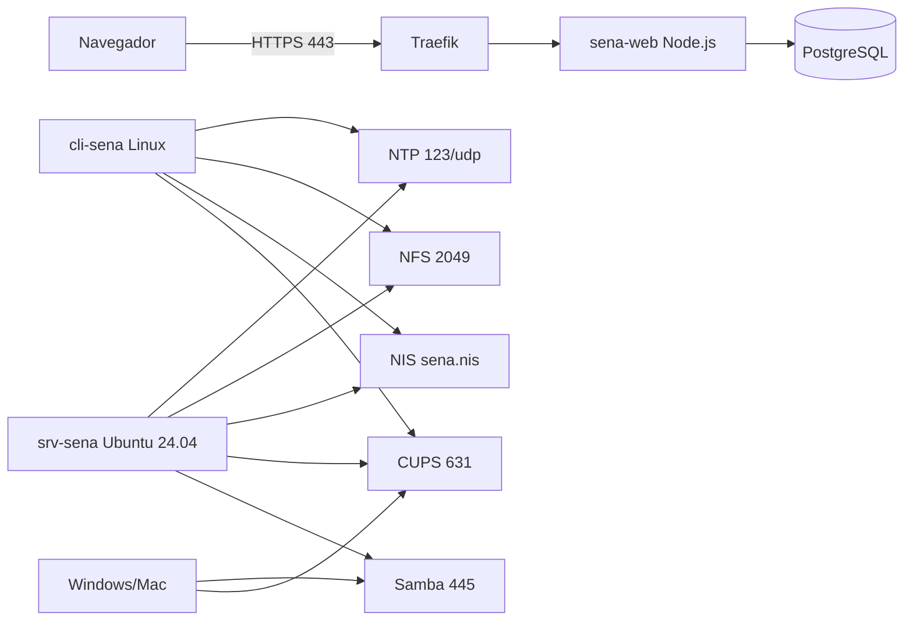

# Análisis y diseño de la infraestructura de TI: SENA

**Empresa:** SENA, Servicio Nacional de Aprendizaje (Colombia)
**Equipo:** Maria José Vasquez, Samuel Salgado y Luisa Fernanda Osorio
**Curso:** Administración de Infraestructura de TI, Universidad del Quindío, 2026-1

## 1. Contexto de la organización

El SENA es un establecimiento público adscrito al Ministerio del Trabajo que ofrece formación profesional gratuita (técnicos, tecnólogos y cursos complementarios) en centros de formación de todo el país. Un centro de formación típico tiene coordinación académica y administrativa, instructores, cientos de aprendices rotando por ambientes de formación (salas de cómputo) y una alta rotación de cuentas cada trimestre.

Este diseño modela la infraestructura de **un centro de formación** con un servidor local que centraliza los servicios.

## 2. Necesidades identificadas

| # | Necesidad del centro | Servicio propuesto |
| --- | --- | --- |
| 1 | Publicar la oferta de programas y recibir registros de interés de aspirantes | Web en Dokploy con HTTPS |
| 2 | Guardar programas e inscripciones de forma persistente | PostgreSQL en Dokploy |
| 3 | Que la hora de todos los equipos coincida (asistencia, registros, logs, certificados SSL) | NTP |
| 4 | Una sola cuenta por aprendiz o instructor que sirva en cualquier equipo Linux de los ambientes | NIS |
| 5 | Que el aprendiz encuentre sus archivos en cualquier equipo Linux y compartir material de clase | NFS |
| 6 | Compartir documentos con la coordinación, que trabaja en Windows | Samba |
| 7 | Impresión centralizada y controlada en los ambientes de formación | CUPS |

## 3. Justificación de cada servicio

**Dokploy + Web (HTTPS).** Dokploy es un PaaS auto-alojado gratuito que construye y despliega la aplicación (desde Git o cargando el código en un .zip), gestiona la base de datos y configura Traefik como proxy inverso con TLS. Evita pagar hosting externo y permite que el equipo de TI del centro actualice el sitio con un nuevo despliegue desde el panel. HTTPS protege los datos personales del formulario (Ley 1581 de 2012 de protección de datos).

**Base de datos PostgreSQL.** Motor libre y robusto. Corre como servicio de Dokploy en la red interna de Docker, sin exponer el puerto 5432 a la red, y la aplicación se conecta con la URL interna.

**NTP.** El SENA registra asistencia, notas y eventos con fecha y hora; los certificados TLS y la autenticación también dependen de relojes sincronizados. El servidor se sincroniza con pool.ntp.org y sirve la hora a la red local.

**NIS.** Cada trimestre ingresan y salen grupos de aprendices. Con NIS las cuentas se crean una sola vez en el servidor y funcionan en todos los equipos Linux del centro, en vez de crearlas equipo por equipo.

**NFS.** Se combina con NIS: las carpetas personales (`/srv/nfs/home`) se montan en el cliente, así el aprendiz encuentra sus archivos en cualquier puesto. La carpeta `/srv/nfs/compartido` guarda material de clase solo para el grupo `sena-staff`, con `root_squash` para que el root de un cliente no tenga control del servidor.

**Samba.** La coordinación académica y administrativa usa Windows. Samba ofrece la carpeta `documentos` por SMB, con usuarios autenticados del grupo `sambashare`.

**CUPS.** Centraliza las colas de impresión de los ambientes: un solo punto para administrar impresoras, ver trabajos y controlar el uso. En el laboratorio se usa una impresora virtual cups-pdf (`SENA-Impresora`), que guarda cada trabajo como PDF.

**Extras: firewall y respaldos.** Como el servidor concentra todos los servicios, se agregó UFW (todo cerrado por defecto, servicios internos solo para las redes del SENA) y un respaldo diario automático de la base de datos de inscripciones, que contiene datos personales de aspirantes.

## 4. Tabla de requisitos

| Servicio | Software | IP del servidor | Puerto | Protocolo | Tipo de servicio | Cliente de prueba |
| --- | --- | --- | --- | --- | --- | --- |
| Panel Dokploy | Dokploy | 192.168.56.10 | 3000 | TCP (HTTP) | Gestión PaaS | Navegador |
| Web institucional | Traefik + Node.js | 192.168.56.10 | 80, 443 | TCP (HTTP/HTTPS) | Aplicación web | Navegador |
| Base de datos | PostgreSQL 18 | Red interna Docker | 5432 | TCP | Base de datos | App sena-web |
| NTP | ntpsec | 192.168.56.10 | 123 | UDP | Sincronización horaria | cli-sena (timesyncd) |
| NFS | nfs-kernel-server | 192.168.56.10 | 2049, 111 | TCP/UDP (NFSv4, RPC) | Archivos Linux | cli-sena |
| NIS | ypserv, ypbind | 192.168.56.10 | 111 + puertos RPC dinámicos | TCP/UDP (RPC) | Autenticación | cli-sena |
| CUPS | cups, cups-pdf | 192.168.80.50 / 192.168.56.10 | 631 | TCP (IPP/HTTPS) | Impresión | cli-sena (`lp`), navegador en Windows |
| Samba | smbd, nmbd | 192.168.80.50 / 192.168.56.10 | 445, 139 TCP; 137-138 UDP | SMB/CIFS | Archivos Windows | Windows / Mac / Linux |
| SSH | OpenSSH | 192.168.56.10 | 22 | TCP | Administración remota | PowerShell en el equipo del administrador |
| Firewall (extra) | UFW | srv-sena | todos | TCP/UDP | Seguridad perimetral | `ufw status verbose` |
| Respaldo (extra) | cron + pg_dump | srv-sena | n/a | n/a | Copia diaria de la base de datos | `/srv/backups/sena-db` |

## 5. Arquitectura

El diagrama completo está en [diagrama.mmd](diagrama.mmd).

**Máquina virtual del servidor:** VirtualBox, Ubuntu Server 24.04 LTS, 2 vCPU, 4 GB RAM, 40 GB, adaptador 1 en modo bridged (IP fija 192.168.80.50) y adaptador 2 host-only (IP fija 192.168.56.10) para que las pruebas no dependan de la red donde se presente.

## 6. Disponibilidad y nivel de centro de datos

Según la norma ICREA-Std-131-2023, esta implementación corresponde a un **Nivel I** (sin redundancia, componentes N, disponibilidad de referencia 95 %), adecuado para un laboratorio o un centro pequeño. Ya se implementó un respaldo automático diario de la base de datos y un firewall. Para producción se recomienda subir a Nivel II con: segundo servidor NIS esclavo (`ypinit -s`), copia de los respaldos fuera del servidor, UPS y discos en RAID 1.

## 7. Costo-beneficio

| Concepto | Esta solución | Alternativa comercial |
| --- | --- | --- |
| Software (Dokploy, Ubuntu, Samba, CUPS, NFS, NIS, PostgreSQL) | $0, todo software libre | Windows Server + CALs, hosting web y BD administrada |
| Hardware | 1 servidor local existente | Igual o servicios en la nube con cobro mensual |
| Hosting web | $0, en el servidor propio | Hosting/PaaS de pago mensual |
| Esfuerzo | Requiere personal con conocimientos de Linux | Menos configuración, más costo de licencias |

Beneficio principal: centraliza cuentas, archivos, impresión y web en un servidor sin costos de licencia, algo importante para una entidad pública con presupuesto limitado. Riesgo principal: un único servidor es punto único de falla (ver sección 6).
